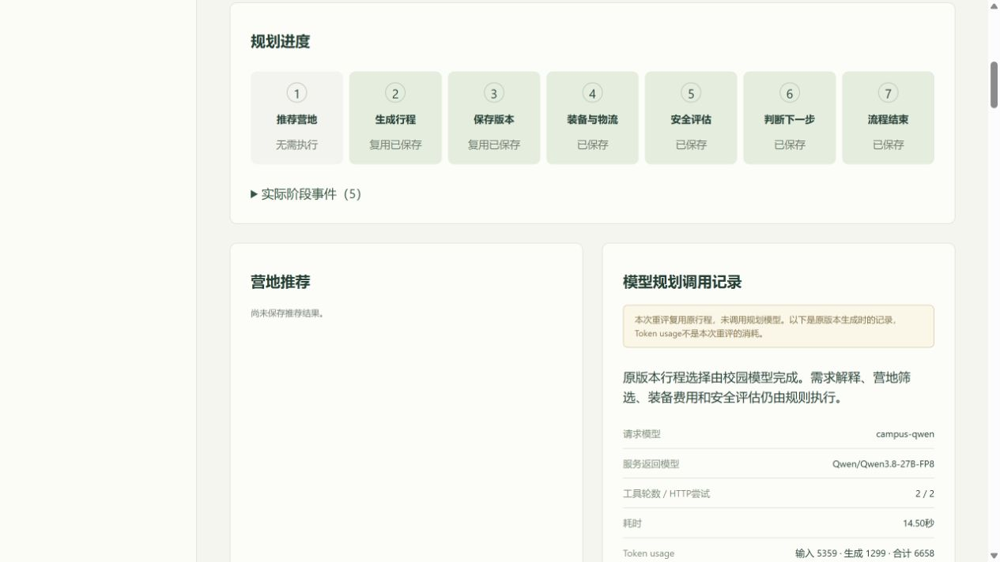

# A19：模型修订与同版本重评真实验收

日期：2026-10-13（Australia/Sydney）。验收应用提交 `11729c8`，完整整合 B PR #4 提交 `22f0681` 与 A18 `17805be`。包含 A17 的历史异常验收记录，保留 A18 相近营地比较、B 的原生成 trace 关联与重新确认提示。顶部说明按后端 supported_operations 显示实际能力，已修正 A 审查 R-01。

## 实现与验证范围

PLAN / REVISE 调用真实校园规划模型；REASSESS 复用原版本并执行新的装备、费用和安全规则评估。需求解释和营地过滤仍为规则。没有扩大为多个模型角色，没有静默模型回退，共享 schema 1.0 与既有数据库结构保持不变。

测试使用用户本机已配置的校园凭据和 USYD VPN，但不修改私人 `.env`、`.env.llm.local` 或用户演示数据库。固定演示时钟及封存 v2 数据按公开场景输入配置。服务仅监听 loopback，使用任务独立端口与数据库；观察用 Client 子类只记录调用次数、返回模型、attempts 和 usage，不替换模型响应、候选或提示。

## 1. 浏览器完整流程：超预算、真实模型修订与重评

独立数据库 `var/a19-live/budget_revision/browser.sqlite3`，前后端 8670 / 5270。

浏览器登录 Camper A，载入并明确保存公开演示资料，填写两人、2026-10-27 开始、两晚三天、AUD245、quiet / ready-to-eat meals。日期由用户可见原始请求中的 ISO 日期提取，确认摘要显示 2026-10-27 至 2026-10-29；用户明确确认后开始规划。

| 步骤 | 实际结果 | 模型调用 |
|---|---|---|
| PLAN | 版本 1，Wattle Rest，规则总费用 AUD251，比预算超出 AUD6，要求修订 | 2 轮 / 2 HTTP attempts，6.58秒，5287 tokens |
| REVISE：寻找费用更低的营地 | 版本 2，Moonlit Field，总费用 AUD231，预算剩余 AUD14，物流 / 安全通过；浏览器确认并最终保存 | 2 轮 / 2 HTTP attempts，14.50秒，6658 tokens |
| REASSESS | 同一版本 2、同一行程内容，新的 run / fingerprint / 两份评估；原 trace 保持 id、生成 run、attempt、usage 和时间 | 0 次新增模型调用 |
| 重评后的最终保存 | 新最终快照保存成功，原最终快照保持历史内容 | 0 次新增模型调用 |
| 前后端重启 | 两份最终快照和 trace 完整回读；重新评估快照明确标注 usage 属于原生成 | 0 次新增模型调用 |

模型实际返回 `Qwen/Qwen3.8-27B-FP8`。首轮和修订的营地均由模型实际选择，没有强制预期营地。Moonlit 的 quiet 偏好不作保证，模型输出的决策摘要仍标为模型说明。AUD251 / AUD231 是 synthetic 行程估算，没有实际订位、付款或把该金额当作 API 费用。

重启前后导出的 scope、版本、审计、评估、最终快照与调用记录逐项相等（导出阶段名称除外）。数据库：1 request、3 runs、2 versions、2 traces、6 assessments、0 reviews、2 final records。Camper B 的浏览器无法读取 Camper A 的最终方案，服务器返回 NOT_FOUND / HTTP404。正常操作与重启回读阶段浏览器 console errors 为 0；跨用户拒绝作为预期 HTTP 错误单独记录。

## 2. 缺失证据重评不能放行

独立数据库 `var/a19-live/missing_evidence/browser.sqlite3`，前后端 8671 / 5271。使用公开 missing_evidence 输入，通过真实 HTTP 登录、确认、调度与校园模型完成首轮规划，再执行同版本重评；浏览器随后读取这些真实保存的结果。该场景不是第二次全程由浏览器创建需求的验收。

实际选择 River Flat，天气证据为 MISSING。重评不增加模型调用或 trace，也不改变原行程。最终保存返回 HTTP409 / FINALISATION_BLOCKED，Founder 批准返回 HTTP409 / INVALID_STATE。页面明确要求先补齐安全证据，没有“保存为最终方案”按钮，浏览器 console errors 为 0。

数据库：1 request、2 runs、1 version、1 trace、4 assessments、0 reviews、0 finals。初次规划 2 次真实模型 completion，重评新增 0 次。

## 3. 真实修订的受控保存回执丢失恢复

独立数据库 `var/a19-live/recovery/http.sqlite3`，使用真实校园 Client / Coordinator / Hybrid、应用 HTTP、dispatcher 和 SQLite。

完成真实 PLAN 后，通过真实模型执行“cheaper campsite”修订。在版本和 trace 的原子事务已经提交后，单次将 A 保存返回替换成 PERSISTENCE_FAILURE。随后关闭应用、重建应用并重试，工作流成功完成，复用同一已保存版本、内容及原生成 trace / attempt，没有追加模型调用。

这是受控 A 保存回执丢失注入，不是校园网络发生了真实故障，不证明所有网络异常已验收。该场景真实模型调用共 4 次，重启后的恢复新增 0 次；2 versions、2 traces、4 assessments，无重复版本或审计。恢复流程为 HTTP 验收，未另做浏览器故障注入。

## 检查与证据

完整集成 `scripts/check.py`：669 passed、44 skipped、0 failed，351.98 秒；44 项是 Windows 文件 symlink 特权缺失，不计为通过。既有 junction 用例执行通过。共享 schema 1.0 检查、TypeScript 与 Vite 构建（54 模块）、pip check 和 git diff --check 均通过。修正冲突和顶部提示后没有更改业务代码来迎合演示结果。

三个场景合计 10 次实际校园 completion / 10 HTTP attempts；成功响应报告 usage 为输入24240、生成3654、总计27894 tokens。这是服务返回的用量记录，不是收费报告。

脱敏验证摘要：[a19-live-revision-reassessment-check.json](evidence/a19-live-revision-reassessment-check.json)。原始本地只读记录与受控恢复证据位于 `var/a19-live/`，不会打包私人凭据或运行数据库。

页面证据：[修订结果](evidence/a19-live-revision.png)、[重评引用原 trace](evidence/a19-live-reassessment-trace.png)、[重启后历史快照](evidence/a19-live-history-after-restart.png)、[用户隔离](evidence/a19-live-owner-isolation.png)、[证据缺失引导](evidence/a19-live-missing-evidence.png)。

尚待完成：其他模型业务角色、完整高风险 / 过期 / 禁火演示覆盖，以及最终 Canvas 下载源码的现场部署演练。项目为 Web 应用；正式提交包在项目完成后生成。本轮验收不替代最终 Canvas 部署验收。
